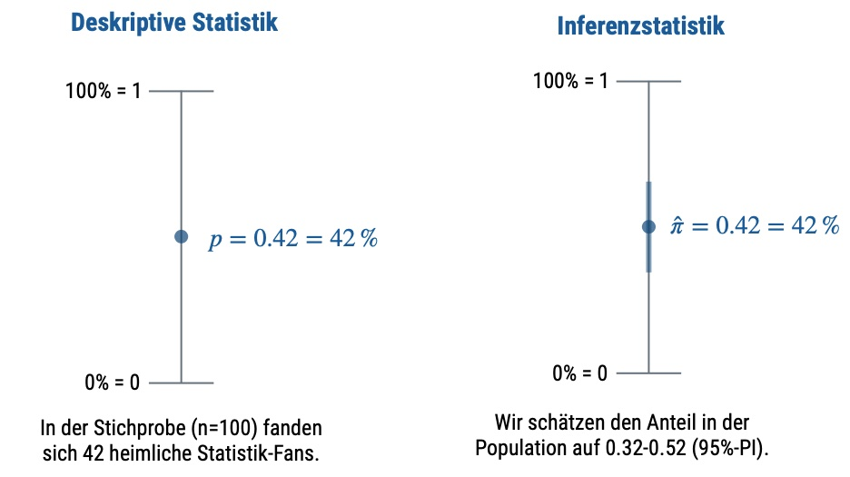

# Populationsinferenz {#sec-inferenz}
<!-- spellcheck: 2026-08-25 -->


## Lernsteuerung


::: {.content-visible when-format="html"}
{width=10% fig-alt="Logo des Buchs: ein gezeichneter grau-blauer Roboter (Golem) mit großen Augen in einem lila Sechseck mit hellgrünem Rand, darüber der Schriftzug „Bayes“."}
:::


```{r}
#| include: false
library(tidyverse)
library(easystats)
library(nycflights13)
```


Nach Absolvieren des jeweiligen Kapitels sollen folgende Lernziele erreicht sein.

Sie können ...

- den Begriff der Populationsinferenz definieren und von der Deskriptivstatistik abgrenzen
- erläutern, warum inferenzstatistische Schlüsse notwendigerweise mit Ungewissheit behaftet sind
- zwischen Ungewissheit zu den Regressionskoeffizienten und Ungewissheit zur Vorhersagegenauigkeit ($\sigma$) unterscheiden
- den Begriff des Konfidenzintervalls (Schätzbereichs) erläutern und interpretieren
- frequentistische und Bayes-Inferenz einander gegenüberstellen
- den p-Wert informell definieren und typische Fehlinterpretationen benennen
- den Begriff der statistischen Signifikanz erläutern
- Null- und Alternativhypothese unterscheiden und anhand von Beispielen erläutern


Bei @gelman2021, Kap. 4, findet sich eine Darstellung, die sich mit den Inhalten dieses Kapitels überschneidet.
Die Begleitliteratur ist nicht prüfungsrelevant; sie dient zur Vertiefung und als
Grundlage einer ausführlicheren Erläuterung des Stoffes.


Bereiten Sie sich im Eigenstudium auf dieses Kapitel vor. Lesen Sie dazu folgende Themen:

- [Statistik 1, Kap. "Rahmen"](https://sebastiansauer.github.io/statistik1/010-rahmen)^[<https://sebastiansauer.github.io/statistik1/010-rahmen>]
- [Statistik 1, Kap. "Punktmodelle 2"](https://sebastiansauer.github.io/statistik1/070-zusammenhaenge)^[<https://sebastiansauer.github.io/statistik1/070-zusammenhaenge>], insbesondere zu Regressionskoeffizienten

::: {.content-visible when-format="html"}
::: {.callout-note}
Die Folien zu diesem Kapitel sind sowohl als [HTML](slides/0250-inferenz.html) als auch als [PDF](slides/0250-inferenz.pdf) verfügbar.
:::
:::


## Einstieg

Angenommen, Sie fragen eine Gruppe von Studierenden, ob sie R mögen, und 42 % antworten mit Ja.
Heißt das, dass auch 42 % *aller* Studierenden R-Fans sind?
Und wenn Sie morgen eine andere Gruppe fragen -- käme dann wieder genau derselbe Wert heraus?
Was ein kleiner Ausschnitt über das große Ganze verrät (und was nicht), darum geht es in diesem Kapitel.

:::{#exr-einstieg-inferenz-desk}
### Beschreiben oder Erklären?
Im letzten Kapitel haben Sie die drei Zielarten der Statistik kennengelernt.
Worin unterscheidet sich die Deskriptivstatistik (Beschreiben) von der Populationsinferenz (Erklären)?
Nennen Sie für beide je ein Beispiel. $\square$
:::

:::{#exr-einstieg-inferenz-vorhersagefehler}
### Wie genau ist eine Regression?
Sie haben eine einfache Regression mit der Lernzeit als UV und den Klausurpunkten als AV berechnet.
Was ist ein Vorhersagefehler (Residuum), und woran erkennen Sie im Streudiagramm, ob die Vorhersagen des Modells eher genau oder eher ungenau sind? $\square$
:::

In diesem Kapitel sehen Sie, warum Schlüsse von der Stichprobe auf die Grundgesamtheit immer mit Ungewissheit behaftet sind und wie man diese Ungewissheit angibt.
Außerdem lernen Sie zwei Wege der Inferenz kennen: die frequentistische Inferenz (mit p-Wert und Signifikanz) und die Bayes-Inferenz.


## Schließen von der Stichprobe auf die Grundgesamtheit 


<!-- ### Inferenz als Generalisieren -->

::: {.content-visible when-format="html"}
📺 [Was ist Inferenz?](https://www.youtube.com/watch?v=QNMVi6IqQ90&list=PLRR4REmBgpIGgz2Oe2Z9FcoLYBDnaWatN)
:::

Populationsinferenz ist das Schließen von der Stichprobe auf die Grundgesamtheit.

Statistische Populationsinferenz -- oft kurz als *Inferenz* bezeichnet -- hat zum Ziel, 
vom Teil aufs Ganze zu schließen, bzw. vom Konkreten auf das Abstrakte.
In der Datenanalyse heißt das: Was sagt mein Datensatz, der auf einer Stichprobe beruht,
über die zugrundeliegende Grundgesamtheit aus?

:::{#exr-stipro}
Typischerweise untersuchen Sie im Rahmen einer statistischen Analyse eine *Stichprobe*,
wie z. B. Ihr Freundeskreis, der leichtsinnig genug war, 
auf Ihre WhatsApp-Nachricht "Tolle Studie zum Geheimnis des Glücks!!!" zu klicken.
Ihr Freundeskreis ist ein *Teil* der Menschen (z. B. aus Deutschland), also eine Stichprobe.
Schauen wir uns den Unterschied zwischen Stichprobe und Population näher an. $\square$
:::


Nehmen wir an, wir möchten herausfinden, 
wie groß der Anteil der R-Fans in der Grundgesamtheit (synonym: Population) aller Studierenden ist.
Den Anteil der R-Fans bezeichnen wir der Einfachheit halber hier mit `A`^[~~Meistens~~ Manchmal darf man bei der Statistik nicht nach einem tieferen Sinn suchen. Ist Statistik eine Art moderne Kunst?].

Das *Grundproblem der Inferenzstatistik* ist, dass wir an Aussagen zur Grundgesamtheit interessiert sind, aber nur eine Stichprobe, also einen Ausschnitt oder eine Teilmenge der Grundgesamtheit (synonym: Population) vorliegen haben.
Wir müssen also den Anteil der R-Fans *in der Population* auf Basis des Anteils *in der Stichprobe* schließen:
Wir verallgemeinern oder generalisieren von der Stichprobe auf die Grundgesamtheit, s. Abb. @fig-pop-sample.


```{r}
#| label: fig-pop-sample
#| echo: false
#| layout-ncol: 2
#| fig-width: 4
#| fig-height: 3.4
#| fig-subcap:
#|   - "Grundgesamtheit (Population)"
#|   - "Stichprobe (Sample): dunkel = gewählt, hell = nicht gewählt"
#| fig-cap: "Population vs. Stichprobe. Die Stichprobe entnimmt einen *Teil* der Daten der Population."
#| fig-alt: "Zwei Raster aus 120 Kacheln mit den Buchstaben A und B. Links die gesamte Population in Dunkelgrau. Rechts die Stichprobe: gewählte Kacheln in Dunkelgrau, nicht gewählte in hellem Grau."
library(ggplot2)

buchstaben <- c(
  "AAAABAAAAAAA",
  "ABAABABABBAB",
  "AABBAABAAAAA",
  "BAABAAABABAA",
  "BABBBAAAAABA",
  "ABABAAAAAAAB",
  "BBBBABBABAAA",
  "AAAABBAAABAA",
  "ABABBABAAAAA",
  "BBAAAABBAAAA"
)
# gewählte Spalten je Zeile (Stichprobe)
gewaehlt <- list(1:11, c(4, 6, 8), c(2, 4, 8, 9, 11, 12), c(5, 6, 7, 12),
                 c(2, 5, 8, 10), c(1, 4, 6, 11, 12), c(3, 4, 5, 9, 10, 11),
                 c(6, 8, 10, 11, 12), c(7, 8, 11, 12), c(1:5, 8, 10, 11))

d_pop <- do.call(rbind, lapply(seq_along(buchstaben), function(i) {
  data.frame(
    zeile = i, spalte = 1:12,
    buchstabe = strsplit(buchstaben[i], "")[[1]],
    gewaehlt = 1:12 %in% gewaehlt[[i]]
  )
}))

# Grautöne: gewählt = dunkel auf hellgrauer Kachel, nicht gewählt = mittelgrau auf fast weiß
grau <- c(`TRUE` = dunkelgrau, `FALSE` = mittelgrau)
kachel <- c(`TRUE` = gitterfarbe, `FALSE` = scales::alpha(hellgrau, 0.5))

plot_raster <- function(d, nur_gewaehlt_hervorheben) {
  d$status <- if (nur_gewaehlt_hervorheben) as.character(d$gewaehlt) else "TRUE"
  ggplot(d, aes(spalte, -zeile)) +
    geom_tile(aes(fill = status), width = 0.94, height = 0.94) +
    geom_text(aes(label = buchstabe, color = status), size = 7) +
    scale_fill_manual(values = kachel, guide = "none") +
    scale_color_manual(values = grau, guide = "none") +
    coord_equal() +
    theme_leer() +
    labs(
      title = "",
      subtitle = "")
}

plot_raster(d_pop, FALSE)
plot_raster(d_pop, TRUE)
```


Häufig ist das praktische Vorgehen recht simpel: 
Ah, in unserer Stichprobe sind 42 % R-Fans!^[Manch einer hätte mit mehr gerechnet; andere mit weniger...]. 
Man schreibt: $p = 0.42$ (`p` wie `proportion`, engl. für "Anteil"). 
Die Stichprobe sei repräsentativ für die Grundgesamtheit aller Studierenden.
Messerscharf schließen wir:
In der Grundgesamtheit ist der Anteil der R-Fans auch 42 %, $\pi=0.42$.


::: {.callout-note}
Wir verwenden lateinische Buchstaben (p), um Kennzahlen einer Stichprobe zu benennen, und griechische ($\pi$) für Populationen. $\square$
:::


:::{#def-inf}
### (Populations-)Inferenzstatistik
*Populations-Inferenzstatistik* -- meist kurz als *Inferenzstatistik* bezeichnet -- 
ist ein Verfahren zum Schließen von Statistiken (eine Kennzahl einer Stichprobe)
auf *Parameter* (eine Kennzahl einer Grundgesamtheit).
Inferenz bedeutet Schließen bzw. Schlussfolgern: 
auf Basis von vorliegenden Wissen wird neues Wissen generiert.
Inferenzstatistik ist ein Verfahren, das mathematische Modelle (oft aus der Stochastik) 
verwendet, 
um ausgehend von einer bestimmten Datenlage auf allgemeine Aussagen zu schließen. $\square$
:::


:::{#exr-inf}
Heute Nacht vor dem Schlafen wiederholen Sie die Definition. Üben Sie jetzt schon mal. $\square$
:::

Für jede beliebige Statistik (Kennzahl von Stichprobendaten) kann man die Methoden der Populationsinferenz verwenden, 
um den zugehörigen Kennwert (Parameter) der Population zu bestimmen, 
s. Tabelle @tbl-kennwerte. 
Da man die Parameter der Population so gut wie nie sicher kennt 
(schließlich
hat man meist nur Auszüge, Teile der Population, also Stichproben),
muss man sich mit *Schätzwerten* begnügen.


```{r}
#| echo: false
#| label: tbl-kennwerte
#| tbl-cap: Bezeichnungen für Kennwerte
#| message: false
x <- tribble(
    ~Kennwert, ~Stichprobe, ~`Grundgesamtheit (Aussprache)`, ~Schätzwert,
   "Mittelwert", "$\\bar{X}$", "$\\mu$ (mü)" ,      "$\\hat{\\mu}$",
  "Streuung",     "$sd$",      "$\\sigma$ (sigma)", "$\\hat{\\sigma}$",
  "Anteil", "$p$", "$\\pi$ (pi)", "$\\hat{\\pi}$",
  "Korrelation", "$r$", "$\\rho$ (rho)", "$\\hat{\\rho}$" ,
  "Regression", "$b$", "$\\beta$ (beta)", "$\\hat{\\beta}$"

)

knitr::kable(x, escape = FALSE, booktabs = TRUE, format = "simple") 
```


Für Statistiken (Daten einer Stichprobe) verwendet man *lateinische* Buchstaben; 
für Parameter (Population) verwendet man *griechische* Buchstaben.


:::{#exr-greek}
Geben Sie die griechischen Buchstaben für typische Statistiken an. Ohne auf die Tabelle zu schauen.😜 $\square$
:::


Meist begnügt man sich  beim Analysieren von Daten nicht mit Aussagen für eine Stichprobe, sondern will auf eine Grundgesamtheit verallgemeinern.

Leider sind die Parameter einer Grundgesamtheit zumeist unbekannt, daher muss man sich mit *Schätzungen* begnügen.
Schätzwerte werden mit einem "Dach" über dem Kennwert gekennzeichnet, s. letzte Spalte in @tbl-kennwerte.


In der angewandten Forschung und im praktischen Leben interessieren häufig Fragen wie:
"Welche Entscheidung ist (wahrscheinlich) besser?".
Da bekanntlich (fast) keine Aussagen sicher sind, spielt *Wahrscheinlichkeit* 
eine wichtige Rolle in den Forschungsfragen bzw. in deren Antworten.

::: {.callout-note}
Wahrscheinlichkeit wird oft mit *Pr* oder *p* abgekürzt, für engl. *probability*. $\square$
:::


:::{#exm-inf}
Sie testen zwei Varianten Ihres Webshops (V1 und V2), die sich im Farbschema unterscheiden und ansonsten identisch sind: Hat das Farbschema einen Einfluss auf den Umsatz?

Dazu vergleichen Sie den mittleren Umsatz pro Tag von V1 vs. V2, $\bar{X}_{V1}$ und $\bar{X}_{V2}$. 
Die Mittelwerte unterscheiden sich etwas, $\bar{X}_{V1} > \bar{X}_{V2}$. 
Sind diese Unterschiede "zufällig" oder "substanziell"? Gilt also $\mu_{V1} > \mu_{V2}$ oder gilt $\mu_{V1} \le \mu_{V2}$? 
Wie groß ist die Wahrscheinlichkeit $Pr(\mu_{V1} > \mu_{V2})$?
:::


## Was ist Populationsinferenz?

:::{#def-popinf}
### Populationsinferenz
*Populationsinferenz* (auch Inferenzstatistik oder schließende Statistik genannt) 
ist der Teilbereich der Statistik, der sich damit befasst, 
von den Daten einer begrenzten Stichprobe auf eine zugrundeliegende Grundgesamtheit (Population) zu verallgemeinern (zu schließen). $\square$
:::

Deskriptivstatistik (Beschreiben) und Inferenzstatistik (Erklären) gehen Hand in Hand:
Mit der Deskriptivstatistik berechnet man Statistiken zur Stichprobe.
Dabei resultiert die Stichprobe durch eine zufällige Auswahl von Objekten aus der Grundgesamtheit.
Mit der Inferenzstatistik verallgemeinert man von der Stichprobe auf die Grundgesamtheit,
s. @fig-desk-inf.

```{mermaid}
%%| label: fig-desk-inf
%%| fig-cap: Zusammenhang von Deskriptivstatistik und Inferenzstatistik
%%| fig-width: 4
graph LR
    %% 1. Definition der Grundgesamtheit (viele Emojis)
    Population["Grundgesamtheit (Population)
    👥👤👨👩👧👦🧑🤝🧑🌍
    (N = groß)"]
    
    %% 2. Definition der Stichprobe (wenige Emojis)
    Sample["Stichprobe
    👤🧑
    (n = klein)"]

     
   
    Population -->|Zufallsauswahl| Sample

   
    Sample -- Inferenzschluss --> Population
    
   
```


### Inferenz beinhaltet Ungewissheit


Inferenzstatistische Schlüsse sind mit *Ungewissheit* 
(Unsicherheit über die Zuverlässigkeit der Ergebnisse) behaftet: 
Schließlich kennt man nur einen Teil (die Stichprobe) eines Ganzen (die Population), 
möchte aber vom Teil auf das Ganze schließen.
Aus diesem begrenzten Wissen resultiert notwendig Ungewissheit über die gesamte Population.


::: {.callout-important}
Nichts Genaues weiß man nicht: 
Schließt man von einem Teil auf das Ganze, so geschieht das unter Unsicherheit. 
Man spricht von *Ungewissheit*, da man sich auf die *Unsicherheit des Wissens* über die Genauigkeit des Schließens bezieht.
:::


Schließt man etwa, dass in einer Grundgesamtheit der Anteil der R-Fans bei 42 % liegt, 
so geschieht das unter Unsicherheit; es ist ungewiss.
Man ist sich nicht sicher, 
dass es wirklich 42 % in der Population sind -- und nicht etwa etwas mehr oder etwas weniger.
Schließlich hat man *nicht* die ganze Population gesehen bzw. vermessen. 
*Sicher* ist man sich hingegen für die Stichprobe (Messfehler einmal ausgeblendet).
Zur Bemessung der Unsicherheit (Ungewissheit) bedient man sich der Wahrscheinlichkeitsrechnung (wo immer möglich).
Die Wahrscheinlichkeitstheorie bzw. -rechnung wird daher auch als die Mathematik des Zufalls bezeichnet.

::: {#def-zufall}

### Zufälliges Ereignis

Unter einem zufälligen (engl. random) Ereignis verstehen wir ein Ereignis, das nicht (komplett) vorherzusehen ist, 
wie etwa die Augenzahl Ihres nächsten Würfelwurfs. Zufällig bedeutet nicht (zwangsläufig), 
dass das Ereignis keine Ursachen besitzt.
So gehorchen die Bewegungen eines Würfels den Gesetzen der Physik, 
nur sind uns diese oder die genauen Randbedingungen nicht (ausreichend) bekannt. $\square$
:::

:::{#exr-muenz}
Welche physikalischen Randbedingungen wirken wohl auf einen Münzwurf ein? $\square$
:::


:::{#exm-muenz}
### Beispiele zur Quantifizierung von Ungewissheit

Aussagen mit Unsicherheit können unterschiedlich präzise formuliert sein.

-   Morgen regnet's $\Leftrightarrow$ Morgen wird es hier mehr als 0 mm Niederschlag geben ($p=97\%$).

-   Methode $A$ ist besser als Methode $B$ $\Leftrightarrow$ Mit einer Wahrscheinlichkeit von 57 % ist der Mittelwert von $Y$ für Methode $A$ höher als für Methode $B$.

-   Die Maschine fällt demnächst aus $\Leftrightarrow$ Mit einer Wahrscheinlichkeit von 97 % wird die Maschine in den nächsten 1-3 Tagen ausfallen, laut unserem Modell.

-   Die Investition lohnt sich $\Leftrightarrow$ Die Investition hat einen Erwartungswert von 42 Euro; mit 90 % Wahrscheinlichkeit wird der Gewinn zwischen -10000 und 100 Euro.
:::


:::{#exr-ungewiss}
Geben Sie weitere Beispiele an!
:::


### Zwei Arten von Ungewissheit

Im Modellieren im Allgemeinen und in Regressionsmodellen im Besonderen lassen sich (mindestens) zwei Arten von Ungewissheiten angeben:


1. Wie (un)gewiss ist man sich über die *Regressionsgewichte*?

2. Wie (un)gewiss ist man sich über die *Vorhersagegenauigkeit*?


#### Betas: Ungewissheit zur Regressionsgeraden

Wenn wir von den Daten der Stichproben auf die Grundgesamtheit schließen,
können wir nicht sicher sein, ob die Regressionskoeffizienten (Achsenabschnitt, Steigung
der Regressionsgeraden) exakt richtig sind, s. @fig-betas-ungewiss.
Wie man in @fig-regr-div sieht, können sich die Koeffizienten des Modells ($\beta_0$, Achsenabschnitt und $\beta_1$, Steigung) unterscheiden.
Woran liegt das?
Zur Erinnerung: Das Modell `lm_ali` berechnen wir wie in @lst-toni2.


```{r}
#| lst-label: lst-toni2
#| lst-cap: Regressionsmodell für Klausurerfolg als Funktion der Lernzeit (`lm_ali`)
noten2 <- read.csv("data/noten2.csv")
lm_ali <- lm(y ~ x, data = noten2)
```


```{r}
#| label: fig-betas-ungewiss
#| fig-cap: "Wir könnten nicht sicher sein, dass der Achsenabschnitt und die Geradensteigung unseres Modells exakt richtig sind. Diese Werte könnten auch etwas größer oder kleiner sein."
#| layout-ncol: 2
#| echo: false
#| fig-subcap:
#|   - "Ungewissheit für den Achsenabschnitt: Die Gerade könnte 'höher' oder 'niedriger' aufgehängt sein."
#|   - "Ungewissheit für die Steigung der Regressionsgeraden: Die Gerade könnte mehr oder weniger steigen."
#| fig-alt:
#|   - "Streudiagramm von Lernzeit (x) und Klausurpunkten (y) mit steigender hellblauer Regressionsgerade. Zwei gestrichelte, parallele Linien liegen 5 Punkte darüber bzw. darunter: gleiche Steigung, aber verschobener Achsenabschnitt."
#|   - "Dasselbe Streudiagramm mit dunkelgrauer Regressionsgerade. Zwei gestrichelte Linien mit gleichem Achsenabschnitt, aber etwas steilerer bzw. flacherer Steigung fächern sich nach rechts hin auf."

p_toni_regr_b0 <- 
  noten2 |> 
  ggplot(aes(x, y)) +
  geom_point() +
 geom_abline(slope = coef(lm_ali)[2], 
             intercept = coef(lm_ali)[1], color = modelcol, linewidth = trend_linienbreite) +
   scale_x_continuous(breaks = c(20, 40, 60, 80, 100)) +
   labs(x = "Lernzeit [h] (x)",
        y = "Klausurpunkte (y)") +
   referenzlinie(slope = coef(lm_ali)[2], intercept = coef(lm_ali)[1] + c(-5, 5))

p_toni_regr_b0


p_toni_regr_b1 <- 
  noten2 |> 
  ggplot(aes(x, y)) +
  geom_point() +
 geom_abline(slope = coef(lm_ali)[2], intercept = coef(lm_ali)[1], color = dunkelgrau, linewidth = trend_linienbreite) +
   scale_x_continuous(breaks = c(20, 40, 60, 80, 100)) +
   labs(x = "Lernzeit [h] (x)",
        y = "Klausurpunkte (y)") +
   referenzlinie(slope = coef(lm_ali)[2] + c(-0.1, 0.1), intercept = coef(lm_ali)[1])

p_toni_regr_b1

```


:::{#exm-flights}
### Stichproben der New Yorker Flüge
Nehmen wir an, wir ziehen ein paar Zufallstichproben aus der Menge (Population) aller Flüge, 
die in New York im Jahre 2013 gestartet sind.
In jeder Stichprobe berechnen wir eine Regression zwischen Flugzeit und Verspätung des Flugs am Ankunftsort.
Sicherlich werden sich die Stichproben in ihren Kennwerten, z. B. in den Koeffizienten der genannten Regression, unterscheiden. $\square$
:::

```{r}
#| echo: false

set.seed(42)
stipro1 <- sample_n(flights, size = 100)

set.seed(3141)
stipro2 <- sample_n(flights, size = 100)

set.seed(2718)
stipro3 <- sample_n(flights, size = 100)
```


```{r}
#| eval: false
#| echo: false
library(nycflights13)
data(flights)

stipro1 <- sample_n(flights, size = 100)
stipro2 <- sample_n(flights, size = 100)
stipro3 <- sample_n(flights, size = 100)
```


::: {.content-visible when-format="html"}

```{r}
#| echo: false
#| output: false
#| cache: false
# Daten fuer die Animation: viele Stichproben (n = 100) aus allen Fluegen,
# je Stichprobe Punkte, Regressionsgerade und 95%-Konfidenzband.
library(tidyverse)
library(nycflights13)
flights_pop <- flights |>
  select(air_time, arr_delay) |>
  drop_na()
lm_pop <- lm(arr_delay ~ air_time, data = flights_pop)

anim_k <- 40
anim_x <- seq(20, 400, length.out = 40)
set.seed(42)
anim_stipros <- map(1:anim_k, \(i) slice_sample(flights_pop, n = 100))

anim_punkte <- map2_dfr(anim_stipros, 1:anim_k, \(d, i) mutate(d, stipro = i))
anim_koef <- map2_dfr(anim_stipros, 1:anim_k, \(d, i) {
  b <- coef(lm(arr_delay ~ air_time, data = d))
  tibble(stipro = i, b0 = b[[1]], b1 = b[[2]])
})
anim_band <- map2_dfr(anim_stipros, 1:anim_k, \(d, i) {
  m <- lm(arr_delay ~ air_time, data = d)
  vh <- predict(m, newdata = tibble(air_time = anim_x), interval = "confidence")
  tibble(stipro = i, x = anim_x, lwr = vh[, "lwr"], upr = vh[, "upr"])
})

ojs_define(
  anim_punkte = anim_punkte,
  anim_koef = anim_koef,
  anim_band = anim_band,
  pop_b0 = coef(lm_pop)[[1]],
  pop_b1 = coef(lm_pop)[[2]],
  farbe_trend = trendfarbe,
  farbe_punkte = dunkelgrau
)
```

Mit dem Regler wählen Sie eine Stichprobe (je 100 Flüge);
der Knopf zieht die Stichproben nacheinander.
Die blassen Linien zeigen die Regressionsgeraden der bisherigen Stichproben,
die gestrichelte Linie die Regressionsgerade in der Population (alle Flüge).
Sehr große Verspätungen (über 150 min) liegen außerhalb des Bildausschnitts.
Unten sammeln sich die Steigungen $b_1$ der bisherigen Stichproben.

```{ojs}
//| echo: false
ap = transpose(anim_punkte)
ak = transpose(anim_koef)
ab = transpose(anim_band)
anim_n = ak.length

viewof stipro_nr = Inputs.range([1, anim_n], {label: "Stichprobe Nr.", step: 1, value: 1})
viewof stipro_play = Inputs.button("Stichproben ziehen (Abspielen)")
```

```{ojs}
//| echo: false
//| output: false
{
  stipro_play;
  if (stipro_play === 0) return;
  const el = viewof stipro_nr;
  let k = 0;
  const id = setInterval(() => {
    k += 1;
    el.value = k;
    el.dispatchEvent(new Event("input", {bubbles: true}));
    if (k >= anim_n) clearInterval(id);
  }, 700);
  invalidation.then(() => clearInterval(id));
}
```

```{ojs}
//| echo: false
//| label: fig-regr-div
//| fig-cap: "Regressionsanalysen mit verschiedenen Koeffizienten aufgrund der Zufälligkeit des Stichprobenziehens (interaktiv): oben die aktuelle Stichprobe mit Regressionsgerade und Konfidenzband, unten die Steigungen aller bisher gezogenen Stichproben"
{
  const xd = [20, 400], yd = [-60, 150];
  const fmt = (z, d) => z.toLocaleString("de-DE", {minimumFractionDigits: d, maximumFractionDigits: d});
  const akt = ak[stipro_nr - 1];
  const bisher = ak.filter(d => d.stipro < stipro_nr);
  const gerade = d => [{x: xd[0], y: d.b0 + d.b1 * xd[0], s: d.stipro},
                       {x: xd[1], y: d.b0 + d.b1 * xd[1], s: d.stipro}];
  const plot1 = Plot.plot({
    width, height: 340, marginLeft: 50,
    x: {label: "Flugdauer [min] (air_time)", domain: xd},
    y: {label: "Verspätung [min] (arr_delay)", domain: yd},
    marks: [
      Plot.line(bisher.flatMap(gerade), {x: "x", y: "y", z: "s", stroke: farbe_trend, strokeOpacity: 0.2, clip: true}),
      Plot.areaY(ab.filter(d => d.stipro === stipro_nr), {x: "x", y1: "lwr", y2: "upr", fill: farbe_trend, fillOpacity: 0.2, clip: true}),
      Plot.dot(ap.filter(d => d.stipro === stipro_nr), {x: "air_time", y: "arr_delay", fill: farbe_punkte, fillOpacity: 0.6, r: 2.5, clip: true}),
      Plot.line(gerade({b0: pop_b0, b1: pop_b1, stipro: 0}), {x: "x", y: "y", stroke: "currentColor", strokeDasharray: "5,4", strokeWidth: 1.5}),
      Plot.line(gerade(akt), {x: "x", y: "y", stroke: farbe_trend, strokeWidth: 2.5, clip: true}),
      Plot.text([`Stichprobe ${stipro_nr}: b0 = ${fmt(akt.b0, 1)}, b1 = ${fmt(akt.b1, 3)}   (Population: b1 = ${fmt(pop_b1, 3)})`],
        {frameAnchor: "top-left", dx: 4, dy: 4, fill: "currentColor"})
    ]
  });
  const b1max = Math.max(0.05, d3.max(ak, d => Math.abs(d.b1)) * 1.1);
  const plot2 = Plot.plot({
    width, height: 140, marginLeft: 50, marginTop: 10,
    x: {label: "Steigung b1 der Stichproben", domain: [-b1max, b1max]},
    y: {axis: null},
    marks: [
      Plot.ruleX([pop_b1], {stroke: "currentColor", strokeDasharray: "5,4", strokeWidth: 1.5}),
      Plot.dotX(ak.filter(d => d.stipro <= stipro_nr), Plot.dodgeY({x: "b1", r: 4,
        fill: d => d.stipro === stipro_nr ? farbe_trend : farbe_punkte,
        fillOpacity: d => d.stipro === stipro_nr ? 1 : 0.5}))
    ]
  });
  return html`<div>${plot1}${plot2}</div>`;
}
```

:::

::: {.content-visible unless-format="html"}

::: {#fig-regr-div layout-ncol=3}

```{r}
#| echo: false
#| label: fig-regr-div-1
#| fig-cap: Stichprobe 1
#| fig-alt: "Streudiagramm von 100 zufällig gezogenen Flügen mit Flugdauer in Minuten (x) und Ankunftsverspätung in Minuten (y). Die Punkte streuen stark, einige haben große Verspätungen; die blaue Regressionsgerade mit Konfidenzband verläuft fast flach."
ggplot(stipro1, aes(x = air_time, y = arr_delay)) +
  geom_point() +
  geom_smooth(method = "lm") +
  labs(x = "Flugdauer [min] (air_time)", y = "Verspätung [min] (arr_delay)")
```

```{r}
#| echo: false
#| label: fig-regr-div-2
#| fig-cap: Stichprobe 2
#| fig-alt: "Streudiagramm einer zweiten Zufallsstichprobe von 100 Flügen (Flugdauer gegen Ankunftsverspätung) mit blauer Regressionsgerade und Konfidenzband. Lage und Steigung der Geraden weichen von denen der anderen Stichproben ab."
ggplot(stipro2, aes(x = air_time, y = arr_delay)) +
  geom_point() +
  geom_smooth(method = "lm") +
  labs(x = "Flugdauer [min] (air_time)", y = "Verspätung [min] (arr_delay)")
```

```{r}
#| echo: false
#| label: fig-regr-div-3
#| fig-cap: Stichprobe 3
#| fig-alt: "Streudiagramm einer dritten Zufallsstichprobe von 100 Flügen (Flugdauer gegen Ankunftsverspätung) mit blauer Regressionsgerade und Konfidenzband. Auch hier unterscheiden sich Achsenabschnitt und Steigung von den anderen Stichproben."
ggplot(stipro3, aes(x = air_time, y = arr_delay)) +
  geom_point() +
  geom_smooth(method = "lm") +
  labs(x = "Flugdauer [min] (air_time)", y = "Verspätung [min] (arr_delay)")
```

Regressionsanalysen mit verschiedenen Koeffizienten aufgrund der Zufälligkeit des Stichprobenziehens
:::

:::


Der Grund für die Schwankungen der Modellparameter zwischen den Stichproben ist die *Zufälligkeit* des *Stichprobenziehens.* 
Je nachdem, wie es der Zufall (oder sonst wer) will, landen bestimmte Fälle (Flüge in unserem Beispiel) in unserer Stichprobe.
Zumeist unterscheiden sich die Stichproben; 
theoretisch könnten sie aber auch rein zufällig gleich sein.

::: {.callout-important}
Stichproben-Kennwerte schwanken um den tatsächlichen Wert in der Population herum. $\square$
:::

Um diese Ungewissheit, die sich in den Schwankungen der Stichproben-Regressionskoeffizienten ausdrückt, anzuzeigen, 
ist ein "grauer Schleier" um die Regressionsgeraden in @fig-regr-div gekennzeichnet.
Dieser graue Schleier gibt also eine Spannbreite anderer,
plausibler Lagen der Regressionsgeraden an, 
die sich in einer anderen Stichprobe auch manifestieren könnten.


#### Sigma: Ungewissheit zur Genauigkeit der Vorhersage

Angenommen, wir sind uns *sicher* über die Werte der Modellparameter ($\beta_0, \beta_1$),
also über die Lage der Regressionsgeraden, anschaulich gesprochen.
Dann bliebe immer noch Ungewissheit, 
wie *genau* die Vorhersagen sind,
wie groß also die Abstände zwischen vorhergesagten und tatsächlichen Werten.
Wenn nicht die richtigen UVs im Modell sind (relevante fehlen oder auch irrelevante sind enthalten), 
dann liegen Vorhersagen und wirkliche Werte weiter auseinander:
diese Streuung kann man als "Rauschen" bezeichnen, s. @fig-resid-var.
Diese Art der Ungewissheit ist dann interessant, 
wenn man Vorhersagen macht und sich fragt, 
wie *präzise* diese Vorhersage ist.
Die Präzision eines Modells kann man mit einem von zwei Kennwerten ausdrücken, die die gleiche Aussage machen.
Diese zwei Kennwerte sind $R^2$ (R-Quadrat) und $\sigma$ (sigma).


:::{#def-sigma}
### Sigma als mittleren Vorhersagefehler
$\sigma$ gibt (grob gesagt) den mittleren Vorhersagefehler des Modells an.
Einfach gesprochen sagt $\sigma$ wie weit eine Vorhersage im Durchschnitt vom wahren Wert entfernt ist. $\square$
:::


```{r}
#| label: fig-resid-var
#| fig-cap: "Regressionsanalyse mit *gleicher* Regressionsgerade, aber *unterschiedlicher* Vorhersagegüte. Die Vorhersagefehler sind mit mit farbigen vertikalen Balken markiert. Je kürzer die Balken, desto besser (genauer) die Vorhersage."
#| fig-subcap: 
#|   - "Geringer Vorhersagefehler (hohe Vorhersagegüte): Die vertikalen Balken sind kurz."
#|   - "Hoher Vorhersagefehler: Die vertikalen Balken sind lang."
#|   - auch hoher Vorhersagefehler
#| fig-alt:
#|   - "Streudiagramm mit 50 Punkten und steigender dunkelgrauer Regressionsgerade; blaue senkrechte Linien verbinden jeden Punkt mit der Geraden. Die Punkte liegen nah an der Geraden, die Linien sind kurz."
#|   - "Dieselbe Regressionsgerade, aber alle Abweichungen sind dreimal so groß: Die Punkte streuen weit um die Gerade, die blauen Residuenlinien sind lang."
#|   - "Dieselbe Regressionsgerade; jeder Punkt liegt genau 2 Einheiten über oder unter der Geraden. Alle blauen Residuenlinien sind daher gleich und recht lang."
#| echo: false
#| layout-ncol: 3

set.seed(42)
d1 <- tibble(
  x = rnorm(50),
  y1 = x + rnorm(50, mean = 0, sd = .5),
)

lm1 <-  lm(y1 ~ x, data = d1)

d1 <-
  d1 |> 
  mutate(pred = predict(lm1)) |> 
  mutate(above_pred = ifelse(y1 > pred, "above", "below"),
         e = resid(lm1),
         e2 = e * 3,
         e3 = ifelse(e > 0, + 2, -2),
         y2 = pred + e2,
         y3 = pred + e3)

ggplot(d1, aes(x, y1)) +
  geom_point() +
  geom_abline(intercept = coef(lm1)[1], slope = coef(lm1)[2], color = dunkelgrau, linewidth = 1) +
  #scale_y_continuous(limits = c(-4, 4)) +
  geom_segment(aes(x = x, xend = x,
                   y = pred, yend = y1),
               color = blue)


ggplot(d1, aes(x, y2)) +
  geom_point() +
  geom_abline(intercept = coef(lm1)[1], slope = coef(lm1)[2], color = dunkelgrau, linewidth = 1) +
 # scale_y_continuous(limits = c(-4, 4)) +
  geom_segment(aes(x = x, xend = x,
                   y = pred, yend = y2),
               color = blue)


# lm3 <- lm(y3 ~ x, data = d1)

ggplot(d1, aes(x, y1)) +
  geom_point(aes(y = y3)) +
  geom_abline(intercept = coef(lm1)[1], slope = coef(lm1)[2], color = dunkelgrau, linewidth = 1) +
 # scale_y_continuous(limits = c(-4, 4)) +
  geom_segment(aes(x = x, xend = x,
                   y = pred, yend = y3),
               color = blue)


```


### Ich weiß, was ich nicht weiß: Ungewissheit angeben


Streng genommen ist eine Inferenz ohne Angabe der Ungewissheit (Genauigkeit der Schätzung) wertlos.
Angenommen, jemand sagt, dass sie den Anteil der R-Fans (in der Population) auf 42 % schätzt, 
lässt aber offen wie *sicher* (präzise) die Schätzung (der Modellparameter) ist.
Wir wissen also nicht, ob z. B. 2 % oder 82 % noch erwartbar sind. Oder ob man im Gegenteil mit hoher Sicherheit sagen kann, die Schätzung schließt sogar 41 % oder 43 % aus.

::: {.callout-important}
Schließt man auf eine Population, schätzt also die Modellparameter, 
so sollte stets die (Un-)Genauigkeit der Schätzung, also die Ungewissheit des Modells, angegeben sein. $\square$
:::


Im Rahmen der Regressionsanalyse schlägt sich die Ungewissheit an zwei Stellen (und in drei Parametern) nieder:

1.  zur Präzision der Regressionsgeraden $\beta_0$, $\beta_1$
2.  zur Modellgüte ($R^2$) bzw. zum Vorhersagefehler, $\sigma$^[$\sigma$, das griechische *s* für Streuung (um die Regressionsgerade herum), manchmal wird auch e wie *error* verwendet]


### Konfidenzintervall


Wir haben gesehen, dass wir die Werte der Parameter nur mit Ungewissheit angeben können (s. @fig-betas-ungewiss und @fig-resid-var).
Um dieser Ungewissheit Rechnung zu tragen, gibt man nicht nur einen einzelnen Wert an,
einen *Punktschätzer*,
sondern man gibt einen *Schätzbereich* auf Basis der Daten an, s. @tbl-toni-params.

Man spricht anstatt von Schätzbereich auch von einem *Konfidenzintervall*.^[Tatsächlich gibt es mehrere Synonyme oder ähnliche Begriffe für Konfidenzintervall. Wir kommen später darauf detaillierter zu sprechen.]

```{r}
#| label: tbl-toni-params
#| tbl-cap: Punktschätzer und Schätzbereiche für die Modellkoeffizienten von `lm_ali`
model_parameters(lm_ali) |>
  select(1,2,5,6) |>
  print_md()
```
Unser Modell gibt den 95 %-Schätzbereich für den Achsenabschnitt an, ca. von 36 bis 56 Klausurpunkten.
Die Steigung wird geschätzt auf ca. 0.7 bis 1.1 Klausurpunkte pro Stunde Lernzeit.

::: {#def-konfintervall}

### Konfidenzintervall

Ein Konfidenzintervall (confidence interval, CI) ist ein Oberbegriff für Schätzbereiche für Parameter wie Regressionskoeffizienten.
Die Grenzen eines Konfidenzintervalls markieren die Grenzen eines Bereichs plausibler Werte für einen Parameter. $\square$

:::


Es gibt verschiedene Arten, Konfidenzintervalle zu berechnen;
wir sprechen in späteren Kapiteln dazu ausführlicher.
Ein Konfidenzintervall wird häufig mit 90 % oder 95 % Genauigkeit angegeben.
Im Kontext der Bayes-Analyse -- auf der dieser Kurs aufbaut -- ist ein Konfidenzintervall einfach zu interpretieren.
Sagen wir, wir finden, dass in einem Modell ein 95 %-Konfidenzintervall für den Anteil der R-Fans angegeben wird,
das sich von 40 bis 44 Prozent erstreckt.
Dieser Befund lässt sich so interpretieren: 

> “Laut Modell liegt der gesuchte Anteil der R-Fans mit einer Wahrscheinlichkeit von 95 % im Bereich von 40 bis 44 Prozentpunkten.”


:::{#exr-ungewisskorr}
Geben Sie Beispiele für Konfidenzintervalle an.
:::


Die Ungewissheit einer (Parameter-)schätzung aufzuzeigen (mit Hilfe eines Konfidenzintervalls), ist der wesentliche Nutzen der Populationsinferenz.
@fig-desk-inf-fans stellt die Deskriptiv- der Populationsinferenzstatistik gegenüber.

{#fig-desk-inf-fans width=70% fig-alt="Zwei senkrechte Skalen von 0 % bis 100 %. Links (deskriptive Statistik) nur ein Punkt bei p = 0.42: In der Stichprobe (n = 100) waren 42 heimliche Statistik-Fans. Rechts (Inferenzstatistik) derselbe Wert mit Intervallbalken: Der Anteil in der Population wird auf 0.32 bis 0.52 geschätzt (95%-PI)."}


##  Frequentistische Inferenz vs. Bayes-Inferenz

Es gibt zwei Hauptarten von Inferenzstatistik: Frequentistische Inferenz und Bayes-Inferenz.


::::{.columns}
:::{.column}
**Frequentismus: Klassische Inferenz**

1. Ziel ist es, den Anteil von Fehlentscheidungen auf lange Sicht zu kontrollieren.
2. Keine Berücksichtigung von Vorwissen zum Sachgegenstand
3. Wahrscheinlichkeit wird über relative Häufigkeiten definiert.
4. Es ist *nicht* möglich, die Wahrscheinlichkeit einer Hypothese bzw. eines Werts in der Population (eines Parameters) anzugeben.
5. Stattdessen wird angegeben, wie häufig eine vergleichbare Datenlage zu erwarten ist, wenn der Versuch sehr häufig (unendlich oft) wiederholt ist.
6. Ein Großteil der Forschung (in den Sozialwissenschaften) verwendet (aktuell) diesen Ansatz.
:::


:::{.column}
**Bayesianische Inferenz**

1. Ziel ist es, die Wahrscheinlichkeit einer Hypothese korrekt zu bemessen.
2.   Vorwissen (Priori-Wissen) fließt explizit in die Analyse ein (zusammen mit den Daten).
3.   *Wenn* das Vorwissen gut ist, wird die Vorhersage durch das Vorwissen genauer, ansonsten ungenauer.
4.   Die Wahl des Vorwissens muss explizit (kritisierbar) sein.
4.   In der Bayes-Inferenz sind Wahrscheinlichkeitsaussagen für Hypothesen möglich.
4.   Die Bayes-Inferenz erfordert mitunter viel Rechenzeit und ist daher erst in den letzten Jahren (für gängige Computer) komfortabel geworden.
:::
::::

### Frequentistische Inferenz und der p-Wert


Der zentrale Kennwert der frequentistischen Inferenz (synonym: Frequentismus) ist der *p-Wert*.

:::{#def-p-wert}
### p-Wert

Der *p*-Wert ist die Wahrscheinlichkeit eines empirischen Befunds (oder noch extremerer Werte), vorausgesetzt die Nullhypothese $H_0$ gilt und man wiederholt den Versuch unendlich oft (mit gleichen Bedingungen, aber zufällig verschieden und auf Basis unseres Modells), vgl. @wasserstein2016. $\square$
:::

Einfacher gesagt:

>  Der *p*-Wert ist die Wahrscheinlichkeit, ein Ergebnis zu erhalten, das mindestens so extrem ist wie das beobachtete, unter der Annahme, dass es keinen Effekt gibt.


Noch einfacher:

- Man nimmt an, dass es keinen Effekt gibt (z. B. kein Zusammenhang zwischen den untersuchten Variablen)

- Dann fragt man: Wie überraschend wären meine Daten unter dieser Annahme?

- Der p-Wert gibt genau diese Überraschungs-Wahrscheinlichkeit an.


<!-- Kurz gesagt: $p := Pr(T'  \ge T| H_0)$. -->


:::{#exr-p}
Recherchieren Sie eine Definition des *p*-Werts und lesen Sie sie einem Freund. 
Beobachten sie die Reaktionen auf Ihre Erklärung. $\square$
:::

Der p-Wert wird oft falsch verstanden [@badenes-ribera2016].
Aber er ist auch nicht leicht zu verstehen, meint Meister Yoda, s. @fig-yoda.
Hier sind einige *FALSCHE* Interpretationen zum p-Wert laut der Autoren:

- Der p-Wert würde die Wahrscheinlichkeit der Nullhypothese oder der Forschungshypothese angeben. 🙊 FALSCH!
- Der p-Wert würde ein inhaltlich bedeutsames, praktisch signifikantes Ergebnis anzeigen. 🙊   FALSCH!


{#fig-yoda width=50% fig-alt="Meme: Meister Yoda aus Star Wars blickt nachdenklich. Oben steht „P-Value Definition“, unten in Yoda-Satzstellung „Forgotton I have“; selbst Yoda hat die Definition des p-Werts vergessen."}


:::{.callout-important}
Ein frequentistisches Konfidenzintervall macht keine Aussage zur Wahrscheinlichkeit 
eines Werts in der Population (eines Parameters). 
Stattdessen wird eine Aussage über das Ergebnis einer sehr häufig wiederholten Stichprobenziehung berichtet. Ob ein bestimmtes (unseres, Ihres) den wahren Wert enthält, 
bzw. mit welcher Wahrscheinlichkeit es den wahren Wert enthält, 
darüber macht das frequentistische Konfidenzintervall keine Aussagen. $\square$
:::


### Bayes-Inferenz

Die zentrale Statistik der Bayes-Inferenz bzw. (synonym) Bayes-Statistik ist die *Posteriori-Verteilung*.

Die Posteriori-Verteilung beantwortet uns die Frage: 
"Wie wahrscheinlich ist die Forschungshypothese (oder Varianten von ihr), jetzt, 
nachdem wir die Daten kennen, auf Basis unseres Modells?"


In der Bayes-Statistik sind Aussagen folgender Art erlaubt:

>    Mit einer Wahrscheinlichkeit von 95 % ist der neue Webshop besser als der alte.
>    Mit einer Wahrscheinlichkeit von 89 % liegt die Wirksamkeit des neuen Medikaments zwischen 0.1 und 0.4.


<!-- 
[In diesem Post](https://sebastiansauer.github.io/data_se/2022/01/27/warum-bayes/) wird für Bayes geworben 
und (einseitig) Stellung pro Bayes bezogen. -->


### Statistische Signifikanz


Im *Frequentismus* spricht man von statistischer Signifikanz, wenn der p-Wert kleiner ist als 5 %: 
$p<0.05$ (oder einen anderen Prozentwert als 5 %, aber meistens wird 5 % hergenommen).
Man nimmt diesen Befund als Beleg, dass man einen Effekt gefunden hat, 
die Hypothese eines Nulleffekts (z.B. kein Zusammenhang von X und Y) also verwerfen kann.
Faktisch verwirft man die Nullhypothese und wertet das Ergebnis als Unterstützung für die Forschungshypothese.
Wichtig: "Verwerfen" heißt nicht "beweisen" -- auch die Forschungshypothese gilt (wie jede wissenschaftliche Hypothese) nie als endgültig bewiesen, sondern bestenfalls als vorläufig nicht widerlegt.


In der *Bayes-Statistik* ist der Begriff der Signifikanz nicht einheitlich definiert. 
Mit Bezug auf @gelman2021 (S. 57) wird in diesem Buch der Begriff wie folgt definiert -- 
mit Gültigkeit sowohl für Bayes-Statistik als auch für Frequentistische Statistik.

:::{#exr-sun-explodes}
Im Comic 1132 von xkcd [@munroe2012xkcd1132] wird sich über das Nicht-Berücksichtigen von Vorab-Informationen (Priori-Verteilung) lustig gemacht.
Erklären Sie den Comic!
:::

:::{#def-signifikanz}
### Statistische Signifikanz im Frequentismus und im Bayesismus
Ist der Wert Null nicht im Schätzbereich enthalten, 
so liegt ein statistisch signifikantes Ergebnis vor. $\square$
:::

Oft werden 95 %-Konfidenzintervalle verwendet, obwohl das nur eine Konvention ist. 
Die Signifikanzaussage bezieht sich immer auf einen Schätzbereich bestimmter Größe,
z. B. 95 % (und des Modells inklusive Daten).

Liegt ein statistisch signifikantes Ergebnis vor, so *verwirft* man die *Nullhypothese* und akzeptiert die *Alternativhypothese* (synonym: Effekthypothese).

:::{#def-nullhyp}
### Exakte Nullhypothese
Die exakte Nullhypothese (meist kurz nur als Nullhypothese bezeichnet), $H_0$, besagt, dass *kein* (null) Effekt (keine Abweichung vom Referenzwert, kein Unterschied zwischen Gruppen, kein Zusammenhang zwischen UV und AV, Veränderung vor vs. nach der Intervention, ...) vorliegt. $\square$
:::

:::{#def-alternativhyp}
### Alternativhypothese (Effekthypothese)
Eine Hypothese, die besagt, dass es einen (substanziellen) Effekt gibt.
Das kann z. B. ein Unterschied zwischen den untersuchten Gruppen sein oder ein
Zusammenhang zwischen den untersuchten Variablen.
Logisch betrachtet ist die Alternativhypothese meist das Gegenteil der Nullhypothese. $\square$
:::

:::{#exm-effekt}
### Beispiele für Effekthypothesen

- Die Trefferquote der Münze ist $\pi = 0.7$ (Kopf), weicht also um 0.2 von 0.5, dem Wert laut Nullhypothese, ab.
- Der Unterschied im mittleren Gewicht zwischen den Gruppen beträgt ca. 500-600 g.
- Der Korrelationskoeffizient $\rho$ liegt bei ca. 0.5 bis 0.7, ist also nicht Null.
- Der standardisierte Regressionskoeffizient $\beta$ liegt bei ca. 0.1 bis 0.2, ist also nicht Null.
- Der Unterschied in Gestimmtheit vor vs. nach der Induktion von Einsamkeit liegt bei $X_d = 0.3$, ist also nicht Null. $\square$
:::


:::{#exm-nullhyp}
### Beispiele für Nullhypothesen

A) $H_0: \mu = 100$ (Der Populationsmittelwert beträgt 100)
B) $H_0: \mu_1 = \mu_2$ (Es gibt keinen Unterschied zwischen den Mittelwerten zweier Gruppen)
C) $H_0: \rho = 0$ (Es besteht kein linearer Zusammenhang zwischen zwei Variablen)
D) $H_0: \pi = 0.5$ (Die Wahrscheinlichkeit für "Erfolg" beträgt 50 %; die Münze ist "fair")
E) $H_0: \mu_1 = \mu_2 = \mu_3 = \mu_4$ (Alle Gruppenmittelwerte sind gleich; bei ANOVA)
F) $H_0: \beta_1 = 0$ (Der Regressionskoeffizient ist null; kein Effekt des Prädiktors)
G) $H_0: \sigma_1^2 = \sigma_2^2$ (Die Varianzen zweier Populationen sind gleich) $\square$
:::

Statistische Signifikanz im Frequentismus (nicht in der Bayes-Statistik) ist auch 
eine Funktion der Stichprobengröße:
Wenn die Stichprobe groß genug ist, wird jeder Test signifikant (sofern der Effekt nicht exakt Null ist).
Daher hat ein signifikantes Ergebnis zwei mögliche Ursachen: 
Der Effekt ist groß oder (auch) die Stichprobe ist groß, s. @fig-pwert2.

```{mermaid}
%%| label: fig-pwert2
%%| fig-cap: "Der p-Wert ist nicht nur eine Funktion der Effektgröße, sondern auch der Stichprobengröße. Große Stichproben werden zwangsläufig signifikant, sofern der Effekt nicht exakt Null ist."
%%| fig-width: 3
flowchart LR
S[Stichprobengröße]
E[Effektgröße]
p[p<0.05]
S-->p
E-->p
```


Übrigens sollte man nicht nur von "Signifikanz", 
sondern von "statistischer Signifikanz" sprechen, um klar zu machen, 
dass man nicht ein Alltagsverständnis von Signifikanz ("groß", "bedeutsam") meint, 
sondern einen wohl definierten statistischen Begriff. Das ist wichtig, 
weil es sonst leicht zu Fehlinterpretationen kommt.


@makowski2019 schlagen vor, welche Kennwerte der Bayes-Statistik analog zum $p$-Wert herangezogen werden können.
Eine Möglichkeit dafür ist der Kennwert *pd* (*probability of direction*).


:::{#exr-smartphone-addiction}
### Abhängigkeit vom Handy

Die Studie von @kabadayi2024 untersucht den Zusammenhang von Smartphone-Abhängigkeit mit gesundheitlichen Problemen wie Depression, Stress, Einsamkeit und Schlafschwierigkeiten bei Heranwachsenden.

Lesen Sie den Abstract der Studie [@kabadayi2024] und Tabelle 2 (sowie alle Teile, die Sie benötigen, um Tabelle 2 zu verstehen).


1. Was ist der stärkste Zusammenhang bzgl. Smartphone-Abhängigkeit? Wie hoch ist er? Wie groß ist die erklärte Varianz des Zusammenhangs?
2. Zwischen welchen Variablen findet sich ein "statistisch signifikanter" Zusammenhang?
3. Erklären Sie, was ein "statistisch signifikanter Zusammenhang" hier bedeutet? $\square$
:::


:::{#exr-pwert}
### Peer Instruction: p-Wert
Der p-Wert ist der zentrale Kennwert der frequentistischen Statistik. Aber er wird immer wieder missverstanden. Welche Aussage zum p-Wert ist korrekt?

A) Ein p-Wert von 0.04 bedeutet, dass die Nullhypothese mit 96 % Wahrscheinlichkeit falsch ist.
B) Ein p-Wert größer als 0.05 beweist, dass die Nullhypothese wahr ist.
C) Ein kleiner p-Wert bedeutet, dass ein großer Effekt vorliegt.
D) Ein p-Wert von 0.01 bedeutet, dass sich bei Wiederholung der Studie mit 99 % wieder ein signifikantes Ergebnis finden wird.
E) Keine der oben genannten. $\square$
:::


## Fazit

In diesem Kapitel ging es um das Schließen von der Stichprobe auf die Grundgesamtheit. Die große Botschaft: Wer vom Teil aufs Ganze schließt, tut das notwendig unter Ungewissheit -- und diese Ungewissheit sollte man stets angeben, etwa mit einem Konfidenzintervall. Zur Bemessung der Ungewissheit bedient man sich der Wahrscheinlichkeitsrechnung; um sie geht es im nächsten Kapitel.

Das Wichtigste in Kürze:

- **Populationsinferenz**: Mit der Deskriptivstatistik beschreibt man die Stichprobe; mit der Inferenzstatistik verallgemeinert man von Statistiken der Stichprobe (lateinische Buchstaben, z. B. $p$) auf Parameter der Grundgesamtheit (griechische Buchstaben, z. B. $\pi$), s. @def-popinf.
- **Ungewissheit**: Da man nur einen Teil der Population kennt, sind inferenzstatistische Schlüsse immer mit Ungewissheit behaftet; Stichproben-Kennwerte schwanken zufällig um den tatsächlichen Wert in der Population herum.
- **Zwei Arten von Ungewissheit**: Im Regressionsmodell ist man sich zum einen über die Regressionskoeffizienten ($\beta_0$, $\beta_1$) ungewiss, zum anderen über die Genauigkeit der Vorhersage, ausgedrückt durch $\sigma$, den mittleren Vorhersagefehler.
- **Konfidenzintervall**: Statt nur eines Punktschätzers gibt man einen Schätzbereich plausibler Werte für einen Parameter an; im Kontext der Bayes-Analyse heißt ein 95 %-Konfidenzintervall: Laut Modell liegt der Parameter mit einer Wahrscheinlichkeit von 95 % in diesem Bereich, s. @def-konfintervall.
- **Frequentismus vs. Bayes**: Die frequentistische Inferenz definiert Wahrscheinlichkeit über relative Häufigkeiten und erlaubt keine Wahrscheinlichkeitsaussagen über Hypothesen; die Bayes-Inferenz bezieht Vorwissen explizit ein und beantwortet mit der Posteriori-Verteilung, wie wahrscheinlich eine Hypothese ist, nachdem wir die Daten kennen.
- **p-Wert**: Er gibt an, wie überraschend die Daten (oder noch extremere) wären, wenn es keinen Effekt gäbe -- er ist *nicht* die Wahrscheinlichkeit der Nullhypothese und zeigt *nicht* an, ob ein Ergebnis praktisch bedeutsam ist.
- **Statistische Signifikanz**: Ist der Wert Null nicht im Schätzbereich enthalten, liegt ein statistisch signifikantes Ergebnis vor; im Frequentismus hängt Signifikanz auch von der Stichprobengröße ab.
- **Null- vs. Alternativhypothese**: Die Nullhypothese $H_0$ besagt, dass *kein* Effekt vorliegt (z. B. $\beta_1 = 0$), die Alternativhypothese (Effekthypothese), dass es einen Effekt gibt; bei einem statistisch signifikanten Ergebnis verwirft man $H_0$ -- bewiesen ist die Alternativhypothese damit aber nicht.

## Aufgaben

Schauen Sie sich die Aufgaben mit dem Tag *inference* auf dem [Datenwerk](https://sebastiansauer.github.io/datenwerk/#category=inference)^[<https://sebastiansauer.github.io/datenwerk/#category=inference>] an.


### Paper-Pencil-Aufgaben


1. [Griech-Buchstaben-Inferenz](https://sebastiansauer.github.io/datenwerk/posts/griech-buchstaben-inferenz/griech-buchstaben-inferenz.html)
2. [inferenz-fuer-alle](https://sebastiansauer.github.io/datenwerk/posts/inferenz-fuer-alle/inferenz-fuer-alle)
3. [ttest-als-regr](https://sebastiansauer.github.io/datenwerk/posts/ttest-als-regr/ttest-als-regr.html)
4. [ttest-skalenniveau](https://sebastiansauer.github.io/datenwerk/posts/ttest-skalenniveau/ttest-skalenniveau.html)
5. [pwert2](https://sebastiansauer.github.io/datenwerk/posts/pwert2/)
6. [interpret-ci](https://sebastiansauer.github.io/datenwerk/posts/interpret-ci/)
6. [interpret-ci2](https://sebastiansauer.github.io/datenwerk/posts/interpret-ci2/)
7. [gruppenvergleich-regression](https://sebastiansauer.github.io/datenwerk/posts/gruppenvergleich-regression/)
12. [Warum-Bayes](https://sebastiansauer.github.io/datenwerk/posts/warum-bayes/warum-bayes)
13. [samples-nyc2](https://sebastiansauer.github.io/datenwerk/posts/samples-nyc2/)
15. [parameter-genau](https://sebastiansauer.github.io/datenwerk/posts/parameter-genau/)
11. [punktschaetzer-reicht-nicht](https://sebastiansauer.github.io/datenwerk/posts/punktschaetzer-reicht-nicht/punktschaetzer-reicht-nicht.html)
12. [aussagen-infstat](https://sebastiansauer.github.io/datenwerk/posts/aussagen-infstat/index.html)

### Aufgaben, für die man einen Computer braucht


1. [korr-als-regr](https://sebastiansauer.github.io/datenwerk/posts/korr-als-regr/korr-als-regr.html)
2. [ungewiss-arten-regr](https://sebastiansauer.github.io/datenwerk/posts/ungewiss-arten-regr/ungewiss-arten-regr.html)
6. [inferenz-fuer-alle](https://sebastiansauer.github.io/datenwerk/posts/inferenz-fuer-alle/inferenz-fuer-alle.html)
7. [adjustieren1a](https://sebastiansauer.github.io/datenwerk/posts/adjustieren1a/adjustieren1a.html)
5. [adjustieren2a](https://sebastiansauer.github.io/datenwerk/posts/adjustieren2a/adjustieren2a.html)
10. [lm-standardfehler](https://sebastiansauer.github.io/datenwerk/posts/lm-standardfehler/lm-standardfehler.html)
9. [vorhersageintervall1](https://sebastiansauer.github.io/datenwerk/posts/vorhersageintervall1/vorhersageintervall1.html)

::: {.content-visible when-format="html"}

### Quiz-Aufgaben

Hier finden Sie Single-Choice-Aufgaben zu diesem Kapitel.
Wählen Sie eine Antwort aus und klicken Sie auf das Häkchen, um sie zu überprüfen;
über das Fragezeichen erhalten Sie die ausführliche Lösung.

```{r quiz-populationsinferenz-setup}
#| include: false
library(exams2forms)

quiz_populationsinferenz_files <- list(
  "exr/populationsinferenz-definition-schoice/populationsinferenz-definition-schoice.Rmd",
  "exr/inferenz-ungewissheit-notwendig-schoice/inferenz-ungewissheit-notwendig-schoice.Rmd",
  "exr/ungewissheit-beta-sigma-schoice/ungewissheit-beta-sigma-schoice.Rmd",
  "exr/ki-interpretation-bayes-freq-schoice/ki-interpretation-bayes-freq-schoice.Rmd",
  "exr/pwert-interpretation-schoice/pwert-interpretation-schoice.Rmd",
  "exr/signifikanz-stichprobengroesse-schoice/signifikanz-stichprobengroesse-schoice.Rmd",
  "exr/signifikanz-gelman-definition-schoice/signifikanz-gelman-definition-schoice.Rmd",
  "exr/frequentismus-bayes-unterschied-schoice/frequentismus-bayes-unterschied-schoice.Rmd",
  "exr/nullhyp-korrelation-schoice/nullhyp-korrelation-schoice.Rmd",
  "exr/alternativhypothese-definition-schoice/alternativhypothese-definition-schoice.Rmd"
)
```

```{r quiz-populationsinferenz}
#| echo: false
#| message: false
#| results: asis
exams2forms(quiz_populationsinferenz_files, n = 1)
```

:::
